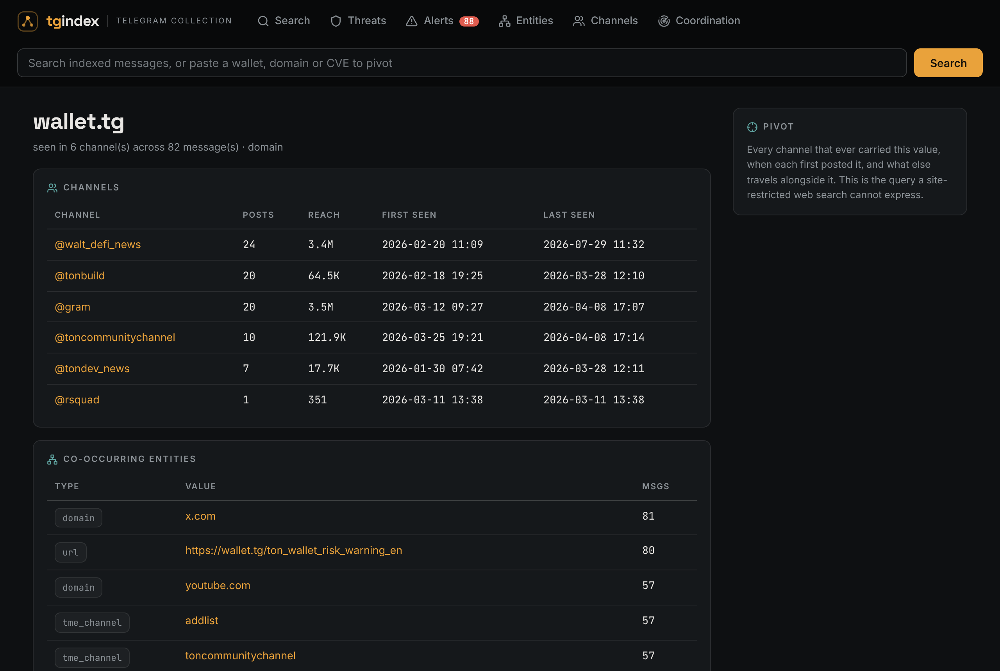

# tgindex

[](https://github.com/sxi9/tgindex/actions/workflows/tests.yml)
[](https://www.python.org/)
[](LICENSE)
[](requirements.txt)

Telegram public-channel search and monitoring. Own crawl, structured index,
validated entity extraction, forward dedup, watchlist alerting, and a threat
layer for leaks, ransomware and credential dumps.

Built as an evaluation prototype: run it against your own channel list and judge
result quality before committing to the production build.


Search blends BM25 with recency and reach, collapses forwards to the origin post
(reporting spread separately), and attaches every extracted entity as a chip you
can pivot on.

## Why this exists

Sites like `telegramsearchengine.com` are not search engines. That one is a
Google Programmable Search Engine (`cx=3efd7fa5ca51ba289`) in a styled wrapper —
you inherit Google's coverage, Google's refresh rate, and no structure at all.

This crawls `t.me/s/` directly, so it has its own coverage and freshness, and it
stores typed documents rather than text blobs. That makes queries possible that a
site-restricted web search structurally cannot express:

| | Google CSE wrapper | tgindex |
|---|---|---|
| Coverage | whatever Google crawled | whatever you crawl |
| Freshness | days to weeks | minutes |
| Filter by date / views / media | no | yes |
| "every channel that posted this wallet" | no | yes (`pivot`) |
| Forward dedup and spread | no | yes (`spread`) |
| Real-time watchlist alerts | no | yes (`watch`) |

### Pivot



Every channel that ever carried a value, when each first posted it, and a ranked
list of what else travels alongside it — each row itself a further pivot.

## Install

```bash
pip install git+https://github.com/sxi9/tgindex
```

That installs a `tgindex` command. Python 3.11+, two dependencies
(`requests`, `lxml`), and SQLite with FTS5 (standard on Ubuntu, macOS and
python.org builds).

## Quickstart

```bash
tgindex quickstart
```

One command: seeds a channel list, crawls it, and reports what it indexed.
Takes about 15 seconds and leaves you with a searchable index.

```bash
tgindex search "security"
```

```bash
tgindex serve
```

Then open `http://127.0.0.1:8000`.

For the threat vertical, start from the bundled cyber list instead:

```bash
tgindex quickstart --seeds cyber-seeds
```

### Where the index lives

A single SQLite file. By default:

| | path |
|---|---|
| Linux | `~/.local/share/tgindex/tgindex.db` |
| macOS | `~/Library/Application Support/tgindex/tgindex.db` |
| Windows | `%LOCALAPPDATA%\tgindex\tgindex.db` |

Override with `--db` or `TGINDEX_DB`. A `tgindex.db` in the working directory
takes precedence, so a repo checkout keeps behaving as before.

```bash
tgindex --db /var/lib/tgindex/index.db stats
```

Global flags go **before** the subcommand.

### The UI never crawls

`serve` only displays what is already indexed; it never fetches anything
itself. Starting it against an empty index prints the fix, and the page says
so rather than showing a bare "no results".

## Commands

| command | what it does |
|---|---|
| `seed <file\|names>` | add channels to the crawl queue |
| `crawl` | drain the queue, snowballing outward to `--depth` |
| `poll` | re-fetch page 1 of active channels (the real-time loop) |
| `search <q>` | BM25 + recency + reach, forward-deduped |
| `pivot <value>` | every channel that posted an entity, plus co-occurrence |
| `spread <uid>` | propagation timeline for a canonical message |
| `watch add/list/rm` | manage the watchlist; adding backfills over the index |
| `alerts` | the alert feed |
| `entities` | top extracted entities by channel spread |
| `facets` | counts by channel, media, entity type |
| `coord` | channel pairs posting identical content in a short window |
| `stats` | index health |
| `serve` | web UI on :8000 |

## How it works

```
seeds ──> crawl t.me/s/<ch>?before=<id> ──> parse ──> ingest ──> index
            ^                                           │
            └──── discovery: forwards, t.me links, @ ────┘
```

Public channels render their whole history as server-side HTML at
`t.me/s/<username>` — no auth, no API key. `?before=<msg_id>` pages backwards.
Everything here is built on that.

**Modules**

- `fetch.py` — token-bucket rate limiter, retry with backoff, `Retry-After` handling
- `parse.py` — HTML to typed records; `<br>`-aware text extraction, forward origin, reply, media, link preview
- `entities.py` — extraction with validation
- `crypto_validate.py` — Keccak-256 (pure Python), base58check, bech32/bech32m, Luhn, IBAN mod-97
- `store.py` — schema, FTS5, dedup, watchlist matching
- `crawl.py` — thread-pool fetch, single-threaded ingest
- `query.py` — search, pivot, spread, facets, coordination
- `web.py` — stdlib UI, no framework

**Entity types.** Validation is the point; unvalidatable candidates are dropped,
not guessed.

`btc` (base58check + bech32/bech32m) · `eth` (EIP-55) · `trx` · `xmr` ·
`domain` (IANA TLD list) · `url` · `ip` (public only) · `email` · `phone` ·
`card` + `card_bin` (Luhn + IIN) · `iban` (mod-97) · `onion` (v2/v3) · `cve` ·
`filehash` · `handle` · `hashtag` · `tme_channel`

**Dedup.** Every message carries `canonical_uid` — the forward origin if known,
else itself. Search collapses on it and reports `copies` and `reach`, so one
viral post is a single result, not 400. The origin is preferred over any forward
even when a forward has far more views: provenance beats reach.

**Alerting.** Two paths, because they are different problems:

- *Entity watches* — O(1) dict lookup against extracted values on ingest. Case
  variants are indexed both ways, so a base58 address typed in the wrong case
  still matches.
- *Keyword watches* (`--type keyword`) — FTS percolation over each ingest batch.
  This is what you want for brand and term monitoring.

Adding a watch backfills over everything already indexed.

## Deliberately not here

- **OCR / ASR.** Cut on cost. The pipeline stores media type and `content_hash`,
  and enrichment is a separate pass, so it can be backfilled later by replaying
  the archive — *provided you keep the media*. See "If you add OCR later".
- **MTProto collection.** Needs an account pool and ongoing ops. Add it per
  channel where you need deletions, media bytes, or membership signals.
- **Vector / hybrid retrieval.** BM25 only for now.

## Production port

SQLite FTS5 stands in for OpenSearch. The document shape is already the target
mapping, so the port is mechanical:

| prototype | production |
|---|---|
| SQLite `messages` + FTS5 | OpenSearch index, same fields |
| `unicode61` tokenizer | per-language analyzers (ICU) — **do this first** |
| `entities` table | nested field + separate pivot index |
| in-process dict watchlist | Redis set lookup |
| keyword watches via FTS | OpenSearch `percolate` |
| in-process crawl loop | fetch workers → Kafka → ingest consumers |
| `requests` + thread pool | same, across an egress IP pool |

The single most important change is the tokenizer. `unicode61` is adequate for
Latin and passable for Cyrillic; it will quietly destroy recall on Arabic,
Persian, and CJK. Fix that before worrying about scale.

### If you add OCR later

Keep media references (file id, `content_hash`, mime type) and ideally the bytes
in S3 from day one. OCR is a worker reading off the same bus, so a stored archive
can be replayed. If media is discarded, that content is gone permanently —
`t.me/s/` only serves what still exists.

## Known limits

- **Public channels only.** No groups, no private/invite-only channels, no
  channels with previews disabled.
- **No deletion tracking.** A scraped index serves content the author removed.
  Retaining deleted messages is a deliberate choice with legal consequences —
  decide it explicitly.
- **Views are approximate.** Telegram serves `4.45M`, so precision is lost above 1K.
- **`1.2.3.4` parses as an IP.** Version strings and IPs are genuinely ambiguous
  in text; this one is left in on purpose rather than guessed away.
- **Username aliases.** A renamed channel serves its old username too. The parser
  resolves to the canonical name from the page header, so aliases merge correctly —
  this is why a crawl of an alias can report `0 new`.
- **Discovery is the real moat.** Your index is only as good as your channel list.
  Curating it is domain work, not engineering work, and it is routinely
  underestimated.

## Legal

Scraping `t.me/s/` reads public HTML, but the corpus contains personal data.
Retention policy, GDPR posture (Art. 14 is a real question for a scraped corpus),
and abuse-material hashing all need deciding before this runs at scale — not
after.

## Tests

```bash
python3 tests.py
```

75 assertions: Keccak-256 and base58check/bech32/EIP-55/Luhn/IBAN against known
vectors, false-positive rejection, dedup and spread, case-insensitive watchlist
matching, threat classification (mention vs actor post), and an assertion that
no credential value reaches any stored entity.
